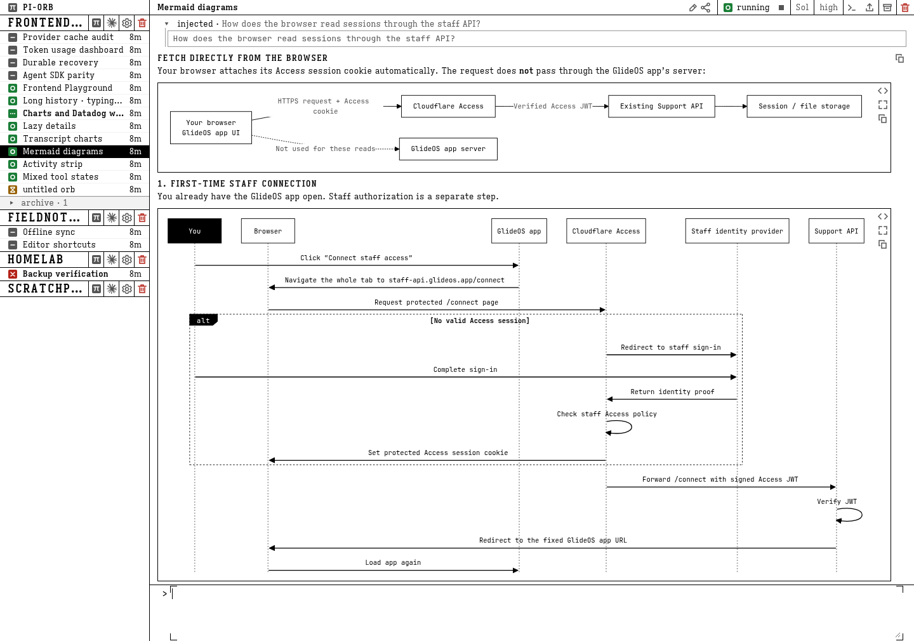

# pi-orb

**Close the tab. Keep the work.**

Persistent coding agents, each with its own conversation and workspace. Work in a browser, disconnect, and pick up the same conversation from another device.

**Intended deployment: Google Cloud (GCP).**



*Real UI, demo data.*

Proof of concept. Expect breaking changes.

## Features

- **Pi and Claude agents.** Choose a harness for each orb. [Pi](docs/pi.md) · [Claude](docs/claude.md)
- **Persistent context.** Workspaces survive compute restarts; read and search history while orbs are stopped. [History](docs/history.md)
- **Browser and mobile.** Resume from another device; install on iPhone or iPad. [Web UI](docs/web-ui.md)
- **Parallel work.** Agents spawn orbs, exchange messages and search each other's transcripts. [Messaging](docs/inbox.md)
- **Interactive terminal.** Work directly in an orb's workspace. [Terminal](docs/terminal.md)
- **File hosting.** Host generated files at durable authenticated URLs. [HTTP exposure](docs/http-exposure.md)
- **HTTP port sharing.** Share running HTTP services with authenticated preview URLs. [HTTP exposure](docs/http-exposure.md)
- **Diagrams.** Render Mermaid diagrams in the transcript. [Web UI](docs/web-ui.md)
- **Charts.** Show charts as interactive transcript rows. [Web UI](docs/web-ui.md)
- **Project integrations.** Connect [MCP servers](docs/mcp.md), manage [credentials and secrets](docs/credentials.md), and prepare environments with [boot hooks](docs/orb-setup-hook.md).

## Deployment

Cloud Run hosts the control plane, GCE hosts orbs, and Cloud SQL provides managed PostgreSQL.

[Deployment instructions](infra/README.md) · [Architecture and release safety](docs/deployment.md)

## Run locally

The modes below are for development/debugging, not production deployments.

Requires Git, Node.js and npm. Toolchain versions: [docs/stack.md](docs/stack.md); npm is pinned in [package.json](package.json). On Linux, `npm ci` also needs Python 3 and `build-essential` to compile `node-pty`; macOS uses its prebuilds.

Install dependencies before choosing a mode:

```sh
npm ci
```

### Docker-backed full service

Requires Docker.

```sh
docker compose up -d
docker build -f apps/orb-runtime/Dockerfile -t pi-orb-runtime:dev .
```

In separate terminals:

```sh
PI_ORB_APP_ORIGIN=http://localhost:5173 npm run dev --workspace @pi-orb/control-plane
npm run dev --workspace @pi-orb/web
```

Open http://localhost:5173.

### Docker-free full service (process hosts)

Real control plane, embedded PGlite and unsandboxed process-hosted orb runtimes. Linux only; run only trusted repositories. The runtime image is not used, so `rustup` and Chromium must be installed on the host.

```sh
# Terminal 1: control plane + PGlite + process supervisor
PI_ORB_APP_ORIGIN=http://localhost:5173 npm run dev:local

# Terminal 2: web UI, proxied to the control plane
npm run dev --workspace @pi-orb/web
```

State defaults to `~/.pi-orb/local`; override with `PI_ORB_PGLITE_PATH` and `PI_ORB_PROCESS_STATE_DIR`. Provider details: [docs/host-provider.md](docs/host-provider.md).

### Frontend-only fixture

UI work without Docker, database, control plane or runtimes:

```sh
npm run dev:frontend
```

Fixture behavior, the restart rule and serving static builds: [docs/web-ui.md](docs/web-ui.md) ("Frontend development").

## Install on iPhone or iPad

Open the HTTPS app in Safari and choose **Share → Add to Home Screen → Add**, leaving **Open as Web App** enabled. Sign in again if prompted. Details: [docs/web-ui.md](docs/web-ui.md).

## Development

[Design & architecture](DESIGN.md) · [Backlog](TODO.md) · [Tests, E2E & DST replay](docs/testing.md)
